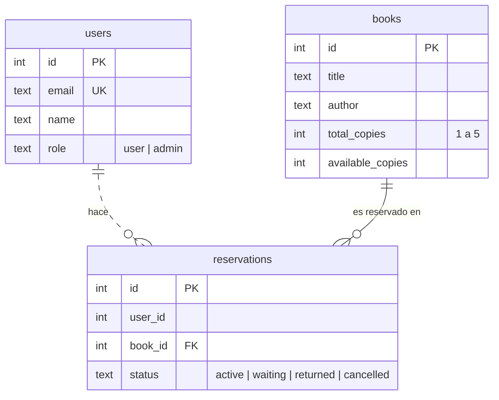
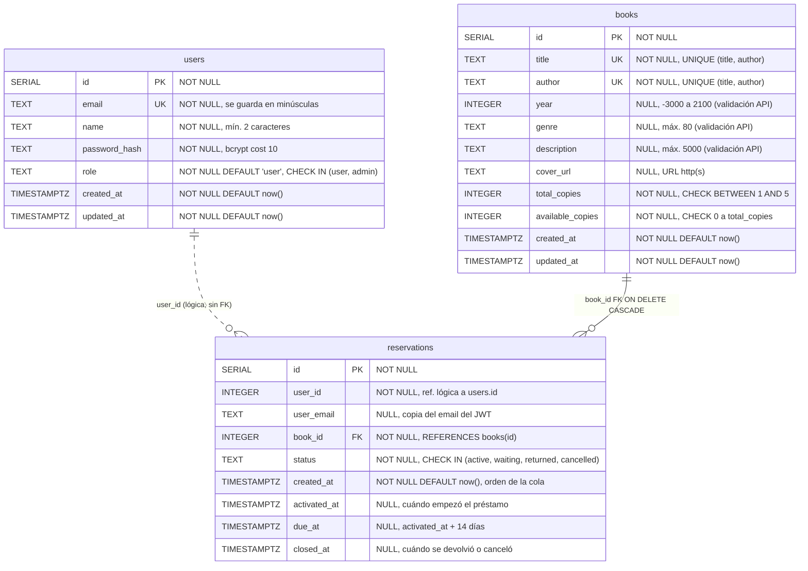
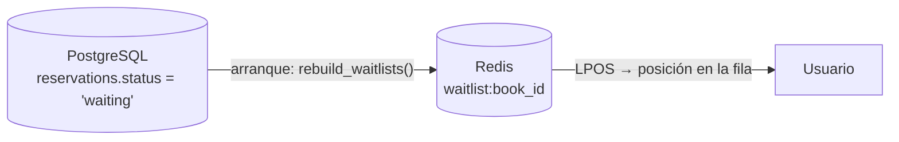

# 01 · Modelado de Datos

**Proyecto:** Biblioteca Virtual (BiblioPop) · **Motor:** PostgreSQL 17 (Amazon RDS en producción, `postgres:17-alpine` en local)
**Base de datos:** `biblioteca` (una sola base compartida por los tres microservicios)

El modelo sale directamente del código. Cada servicio crea sus propias tablas al arrancar con `CREATE TABLE IF NOT EXISTS`:

| Tabla | Servicio dueño | Dónde se define |
|---|---|---|
| `users` | auth-service (Node + Express) | `services/auth-service/src/db.js` |
| `books` | catalog-service (FastAPI) | `services/catalog-service/app/deps.py` |
| `reservations` | reservation-service (FastAPI) | `services/reservation-service/app/deps.py` |

> **Orden de arranque:** `reservations` tiene una FK hacia `books`, así que reservation-service espera hasta 20 × 3 s a que exista la tabla `books` (`to_regclass('public.books')`) antes de crear la suya.

---

## 1. Diagrama Entidad-Relación (conceptual)

Muestra las entidades, sus atributos clave y la cardinalidad de las relaciones.

**Cómo leer las relaciones:**

| Relación | Cardinalidad | Tipo | Explicación |
|---|---|---|---|
| `books` → `reservations` | 1 : 0..N | **Física** (línea continua) | FK real `reservations.book_id → books.id` con `ON DELETE CASCADE`. |
| `users` → `reservations` | 1 : 0..N | **Lógica** (línea punteada) | `reservations.user_id` guarda el `id` del usuario que viene en el JWT (`sub`), pero **no hay FK** en la base. Es a propósito: `users` pertenece a auth-service y los microservicios no deben depender del esquema de otro. Además se guarda `user_email` como copia para mostrarlo sin consultar a auth-service. |

**Regla de cardinalidad extra:** un usuario puede tener como máximo **una** reserva *abierta* (`active` o `waiting`) por libro. Las cerradas (`returned`, `cancelled`) pueden repetirse sin límite. Esto lo garantiza un índice único parcial (ver más abajo).

---

## 2. Diagrama Relacional (físico)

Tipos de PostgreSQL, PK, FK, UK y restricciones `CHECK`, tal como están en el DDL.

### 2.1 Diccionario de datos

#### `users`

| Columna | Tipo | Nulo | Default | Restricción | Descripción |
|---|---|---|---|---|---|
| `id` | `SERIAL` | No | secuencia | **PK** | Identificador. Va en el claim `sub` del JWT. |
| `email` | `TEXT` | No | — | **UNIQUE** | Correo en minúsculas. Es el usuario para entrar. |
| `name` | `TEXT` | No | — | — | Nombre visible (mín. 2 caracteres, validado en la API). |
| `password_hash` | `TEXT` | No | — | — | Hash bcrypt. La contraseña en texto plano nunca se guarda. |
| `role` | `TEXT` | No | `'user'` | `CHECK (role IN ('user','admin'))` | Rol para la autorización. |
| `created_at` | `TIMESTAMPTZ` | No | `now()` | — | Fecha de alta ("Miembro desde…"). |
| `updated_at` | `TIMESTAMPTZ` | No | `now()` | — | Última modificación del perfil. |

#### `books`

| Columna | Tipo | Nulo | Default | Restricción | Descripción |
|---|---|---|---|---|---|
| `id` | `SERIAL` | No | secuencia | **PK** | Identificador del libro. |
| `title` | `TEXT` | No | — | **UNIQUE (title, author)** | Título (1–300 caracteres). |
| `author` | `TEXT` | No | — | **UNIQUE (title, author)** | Autor (1–200 caracteres). |
| `year` | `INTEGER` | Sí | — | — | Año de publicación. |
| `genre` | `TEXT` | Sí | — | — | Género o "sección" del catálogo. |
| `description` | `TEXT` | Sí | — | — | Sinopsis. |
| `cover_url` | `TEXT` | Sí | — | — | URL de la portada. Si está vacía, el frontend genera una. |
| `total_copies` | `INTEGER` | No | — | `CHECK (total_copies BETWEEN 1 AND 5)` | Copias físicas del título. |
| `available_copies` | `INTEGER` | No | — | `CHECK (available_copies >= 0 AND available_copies <= total_copies)` | Copias libres en este momento. |
| `created_at` | `TIMESTAMPTZ` | No | `now()` | — | Alta en el catálogo. |
| `updated_at` | `TIMESTAMPTZ` | No | `now()` | — | Último cambio (incluye préstamos y devoluciones). |

#### `reservations`

| Columna | Tipo | Nulo | Default | Restricción | Descripción |
|---|---|---|---|---|---|
| `id` | `SERIAL` | No | secuencia | **PK** | Identificador de la reserva. También es el valor que se mete en la cola de Redis. |
| `user_id` | `INTEGER` | No | — | Referencia lógica a `users.id` | Dueño de la reserva. |
| `user_email` | `TEXT` | Sí | — | — | Copia del email (sirve para los listados del admin). |
| `book_id` | `INTEGER` | No | — | **FK** → `books(id)` `ON DELETE CASCADE` | Libro reservado. |
| `status` | `TEXT` | No | — | `CHECK (status IN ('active','waiting','returned','cancelled'))` | Estado (ver diagrama de estados en el documento 02). |
| `created_at` | `TIMESTAMPTZ` | No | `now()` | — | Momento de la solicitud. Decide el orden en la lista de espera. |
| `activated_at` | `TIMESTAMPTZ` | Sí | — | — | Inicio del préstamo. |
| `due_at` | `TIMESTAMPTZ` | Sí | — | — | Vencimiento (`activated_at + 14 días`). |
| `closed_at` | `TIMESTAMPTZ` | Sí | — | — | Cierre por devolución o cancelación. |

### 2.2 Índices

| Índice | Tabla | Definición | Para qué sirve |
|---|---|---|---|
| `users_email_key` | `users` | `UNIQUE (email)` (implícito) | Login por email y evitar duplicados. |
| `books_title_author_key` | `books` | `UNIQUE (title, author)` (implícito) | No repetir un título del mismo autor. |
| `books_title_idx` | `books` | `(lower(title))` | Búsqueda sin distinguir mayúsculas. |
| `books_author_idx` | `books` | `(lower(author))` | Búsqueda sin distinguir mayúsculas. |
| `reservations_open_uniq` | `reservations` | `UNIQUE (user_id, book_id) WHERE status IN ('active','waiting')` | **Una sola reserva abierta por usuario y libro.** |
| `reservations_user_idx` | `reservations` | `(user_id)` | Pantalla "Mis reservas". |
| `reservations_waiting_idx` | `reservations` | `(book_id, created_at) WHERE status = 'waiting'` | Reconstruir las colas en orden. |

> Los índices de búsqueda son B-tree sobre `lower(...)`. Como las consultas usan `LIKE '%texto%'` (con comodín al inicio), PostgreSQL no puede aprovecharlos para ese filtro. Con 100 libros no importa. Si el catálogo creciera mucho, convendría un índice `pg_trgm` (GIN).

### 2.3 Invariantes de negocio

1. `0 ≤ available_copies ≤ total_copies ≤ 5` (`CHECK` en la base).
2. `total_copies − available_copies` = número de reservas `active` de ese libro (lo mantiene la lógica transaccional).
3. Solo puede haber reservas `waiting` de un libro cuando `available_copies = 0`.
4. Toda operación que cambia copias bloquea primero la fila del libro (`SELECT … FOR UPDATE`), así dos operaciones sobre el mismo libro nunca corren a la vez.

---

## 3. Estructuras auxiliares en Redis (no relacionales)

PostgreSQL es la **fuente de verdad**. Redis 7 se usa solo como caché y para la cola. Si Redis se vacía, reservation-service reconstruye las colas desde las filas `waiting` al arrancar.

| Clave | Tipo | Servicio | Contenido |
|---|---|---|---|
| `waitlist:{book_id}` | `LIST` | reservation | IDs de `reservations` en espera, en orden de llegada (FIFO: `RPUSH` para entrar, `LPOP` para salir). |
| `books:cache_version` | `STRING` (entero) | catalog / reservation | Versión de la caché. Se incrementa (`INCR`) cada vez que cambia el catálogo o la disponibilidad. |
| `books:v{n}:{q}:{genre}:{page}:{limit}` | `STRING` (JSON) | catalog | Página del catálogo en caché, con TTL de 120 s. |

