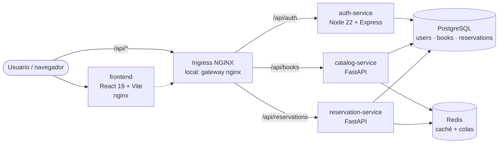
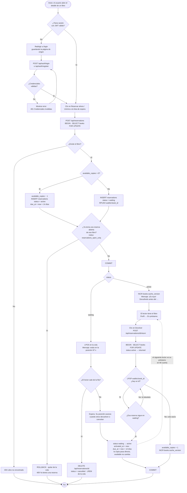
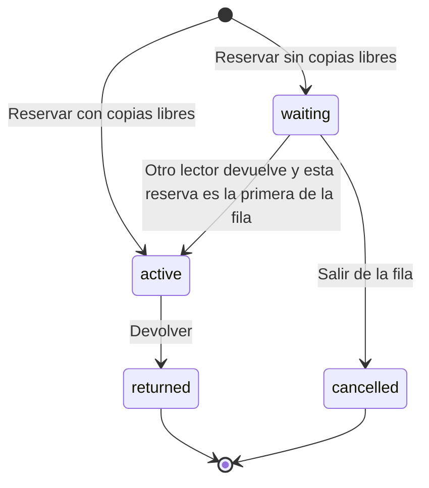
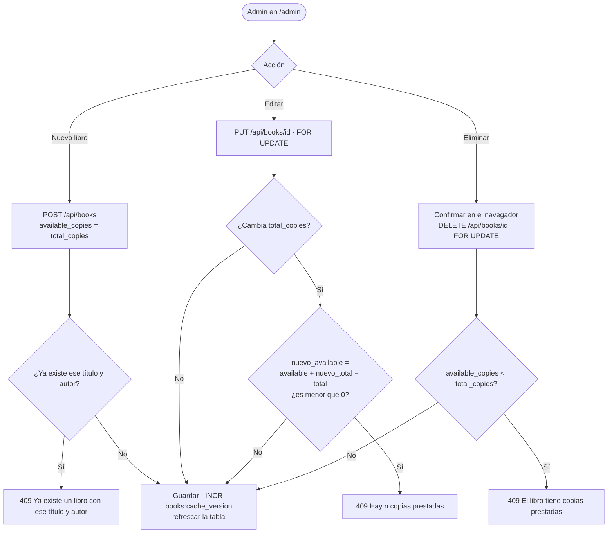

# 02 · Arquitectura de Procesos

El **proceso principal** de BiblioPop es el ciclo de préstamo: *reservar → (esperar en la fila) → devolver → la copia pasa al siguiente*. Todo lo demás (registro, catálogo, administración) existe para que este ciclo funcione.

Requisitos que cubre este documento: RF-11 a RF-16 (ver [03_Matriz_de_Requerimientos.md](03_Matriz_de_Requerimientos.md)).

## 1. Vista de componentes

Los tres servicios validan el mismo JWT (HS256, secreto compartido `JWT_SECRET`) sin llamarse entre sí. auth-service emite el token, y catalog y reservation solo lo verifican.

## 2. Diagrama de flujo del proceso principal

### Puntos importantes del flujo

| Paso | Qué protege | Cómo |
|---|---|---|
| `SELECT … FOR UPDATE` sobre `books` | Que dos personas no se lleven la última copia a la vez | Bloqueo de fila. Reservar y devolver usan el mismo orden de bloqueo (libro primero), así que no hay deadlocks. |
| `RPUSH` dentro de la transacción | Que una devolución que ocurre al mismo tiempo no se salte a quien acaba de entrar a la fila | Se encola mientras se tiene el bloqueo del libro. Si la transacción falla, se hace `LREM`. |
| Bucle `LPOP` | IDs obsoletos en la cola (por ejemplo, reservas canceladas) | Solo se promueve una reserva si sigue en `waiting`. Si no, se toma la siguiente. |
| `LPUSH` de compensación | Que no se pierda el primero de la fila si la devolución falla | Si hay `ROLLBACK`, el ID promovido vuelve a la cabeza de la cola. |
| `INCR books:cache_version` | Que el catálogo no muestre disponibilidad vieja | Solo se incrementa cuando cambia `available_copies`. Si la copia pasa directo a otro lector, la disponibilidad sigue igual. |

## 3. Ciclo de vida de una reserva (diagrama de estados)

| Estado (BD) | Etiqueta en la UI | Color |
|---|---|---|
| `active` | En préstamo | Teal `#2EC4B6` |
| `waiting` | En espera (+ chip "#n en la fila") | Amarillo `#FFD23F` |
| `returned` | Devuelto | Blanco |
| `cancelled` | Cancelado | Blanco |

Una reserva `active` **no se puede cancelar** (hay que devolverla), y una `waiting` **no se puede devolver** (hay que cancelarla). Si se intenta, la API responde 409.

## 4. Flujo de administración del catálogo

## 5. Verificación de coherencia (flujo ↔ requisitos)

| Requisito | Dónde aparece en el flujo | ¿Coincide? |
|---|---|---|
| RF-02 Iniciar sesión | Rama "¿Tiene sesión?" → login | ✓ |
| RF-11 Préstamo inmediato de 14 días | `available_copies > 0` → `active`, `due_at = now + 14 días` | ✓ |
| RF-12 Lista de espera con posición | `waiting` + `RPUSH` + `LPOS` | ✓ |
| RF-13 Una reserva abierta por libro | Índice `reservations_open_uniq` → 409 | ✓ |
| RF-14 Devolución con promoción automática | Bucle `LPOP` → `waiting → active`. Si la cola está vacía, `available + 1` | ✓ |
| RF-15 Cancelar reserva en espera | `DELETE` → `cancelled` + `LREM` | ✓ |
| RF-16 Consultar mis reservas | "Perfil → En préstamo" | ✓ |
| RF-09 / RF-10 Reglas de edición y borrado | Flujo de administración, nodos X2 y X3 | ✓ |
