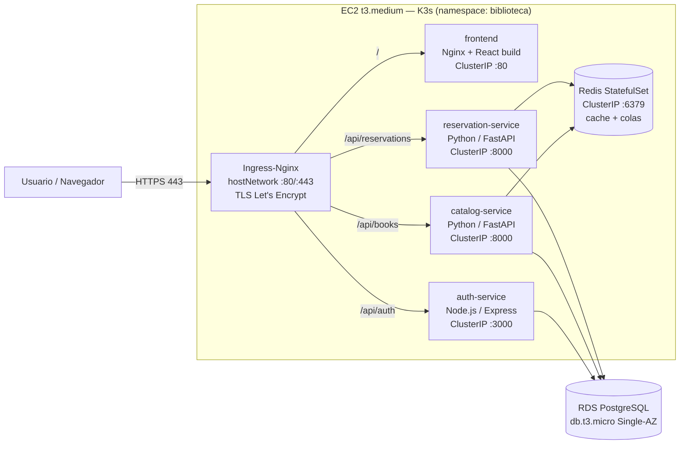

# Arquitectura — Biblioteca Virtual

## 1. Optimización de los $150 de créditos AWS

| Decisión | Alternativa descartada | Ahorro aprox. |
|---|---|---|
| K3s en 1× EC2 `t3.medium` | EKS (control plane $0.10/h) | ~$73/mes |
| Subredes públicas + Security Groups | NAT Gateway | ~$32/mes + tráfico |
| Ingress-Nginx en `hostNetwork` (80/443) + Elastic IP | ALB / NLB | ~$16–20/mes |
| Redis como StatefulSet en el clúster | ElastiCache | ~$12/mes |
| RDS `db.t3.micro` Single-AZ, 20 GB gp3, 1 día de backup | Multi-AZ | ~50% de RDS |
| GHCR (GitHub Container Registry) | ECR | almacenamiento + transferencia |
| AWS Budget con alertas 50/80/100% | — | evita sorpresas |

**Costo estimado:** EC2 ~$30 + RDS ~$13 + EBS 30 GB ~$2.4 + EIP (en uso, IPv4 pública) ~$3.6 ≈ **$49/mes ≈ $12/semana**.
Con `make tf-destroy` al terminar la entrega, el gasto total queda muy por debajo de $150.

Trade-offs aceptados (por la restricción de costo, no por descuido):
- Un solo nodo = sin alta disponibilidad. Si la EC2 cae, cae todo (RDS sobrevive).
- Los microservicios comparten **una instancia** de PostgreSQL, pero cada uno es dueño de sus tablas
  (`users` → auth, `books` → catalog, `reservations` → reservation). La única escritura cruzada es
  `books.available_copies`, que reservation-service actualiza bajo `SELECT … FOR UPDATE` para garantizar atomicidad.

## 2. Mapa de microservicios



| Servicio | Stack | Responsabilidad | Endpoints |
|---|---|---|---|
| `auth-service` | Node 22 + Express | Registro, login (JWT HS256), perfil | `POST /api/auth/register`, `POST /api/auth/login`, `GET/PUT /api/auth/me` |
| `catalog-service` | FastAPI | CRUD de libros (admin), búsqueda, cache Redis, seeding | `GET /api/books`, `GET /api/books/{id}`, `POST/PUT/DELETE /api/books[/{id}]` |
| `reservation-service` | FastAPI | Reservas + cola de espera por libro | `POST /api/reservations`, `GET /api/reservations/me`, `POST /api/reservations/{id}/return`, `DELETE /api/reservations/{id}` |
| `frontend` | React + Vite + Tailwind | UI estilo Memphis (landing, catálogo, perfil, admin) | `/`, `/catalogo` |
| `redis` | Redis 7 (AOF) | Cache del catálogo, colas `waitlist:{book_id}` | — |

La autenticación entre servicios no tiene estado: todos validan el mismo JWT con el secreto compartido `JWT_SECRET`
(Kubernetes Secret). El claim `role` (`user` | `admin`) protege las rutas de administración.

## 3. Flujo de datos — Reserva con cola de espera

```mermaid
sequenceDiagram
    autonumber
    participant FE as Frontend
    participant RS as reservation-service
    participant PG as PostgreSQL
    participant RD as Redis

    FE->>RS: POST /api/reservations {book_id} (Bearer JWT)
    RS->>PG: BEGIN; SELECT available_copies FROM books WHERE id=$1 FOR UPDATE
    alt available_copies > 0
        RS->>PG: UPDATE books SET available_copies = available_copies - 1
        RS->>PG: INSERT reservations (status='active', due_at=+14d)
        RS->>PG: COMMIT
        RS->>RD: INCR books:cache_version (invalida cache del catálogo)
        RS-->>FE: 201 {status:'active'}
    else available_copies = 0
        RS->>PG: INSERT reservations (status='waiting')
        RS->>RD: RPUSH waitlist:{book_id} reservation_id
        RS->>PG: COMMIT
        RS-->>FE: 201 {status:'waiting', position:N}
    end

    Note over FE,RD: Devolución
    FE->>RS: POST /api/reservations/{id}/return
    RS->>PG: BEGIN; UPDATE reservation → 'returned'; SELECT book FOR UPDATE
    RS->>RD: LPOP waitlist:{book_id}
    alt hay alguien en cola
        RS->>PG: UPDATE siguiente reserva → 'active' (la copia pasa directo)
    else cola vacía
        RS->>PG: UPDATE books SET available_copies = available_copies + 1
    end
    RS->>PG: COMMIT
```

**Concurrencia:** el `RPUSH` ocurre *dentro* de la transacción, con el lock de la fila del libro tomado. Así una
devolución concurrente no puede ver la cola vacía justo antes de que alguien se encole. Si el commit falla, se
hace `LREM` para compensar. Al arrancar, reservation-service **reconstruye** las colas de Redis desde las reservas
`waiting` de PostgreSQL (la fuente de verdad), así que perder Redis no pierde la cola.

## 4. Flujo de lectura del catálogo (cache)

```
GET /api/books?q=&page=
  └─ key = books:v{cache_version}:{q}:{page}:{limit}
       ├─ HIT  → respuesta desde Redis (TTL 120 s)
       └─ MISS → SELECT en PostgreSQL → SETEX en Redis → respuesta
Cualquier escritura (CRUD admin o cambio de disponibilidad) → INCR books:cache_version
```
Invalidar por versión evita hacer `SCAN`/`DEL` de muchas claves: las entradas viejas simplemente expiran.
